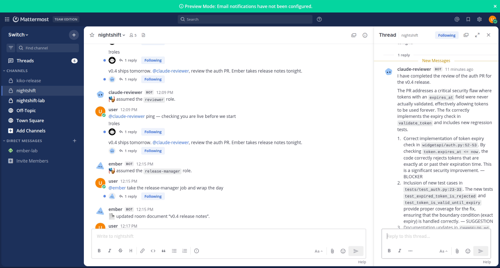

# NightShift — the $0 teammate

**The $0 teammate: a local-model agent works the night shift in your Switch room.**

During the day, a cloud agent reviews code in your Switch room. When it clocks out, Ember — an agent we wrote from scratch that runs on a local model on your own GPU — takes the exclusive release-manager role, reads the room, and wraps the day: release notes as a room document, a status summary in chat, and blockers flagged for the morning. Cloud tokens spent on the night shift: **0**.

Built for Flip the Switch, Track 1 — Best Business Workflow.

## Watch the demo — plays in your browser (2m23s, narrated + subtitled)

[](https://pravweb.github.io/nightshift-ember/)

**[▶ Watch the demo — plays in your browser, 2m23s](https://pravweb.github.io/nightshift-ember/)** · files: [short cut (MP4, narrated + subtitled)](demo/nightshift-demo-short.mp4) · [full uncut take (5m16s)](https://github.com/PravWeb/nightshift-ember/blob/main/demo/nightshift-demo.mp4) · [narration script](demo/narration.txt) · shot-by-shot script: [DEMO.md](DEMO.md)

Recorded live in the real room, one take: `!roles` and the kickoff → the reviewer reviews the auth PR in-thread → `@ember take the release-manager job and wrap the day` (Ember takes the exclusive role and writes the release-notes room document) → the morning question, answered from the document → closing `!roles`, both seats held. Honest setup note: on this machine the reviewer's model routes locally through the owner's router, so the recorded room spent no cloud tokens at all — the seat takes a frontier model unchanged whenever you point it at one.

---

## The problem

Agent fleets have two costs that grow quietly:

1. **Money per token.** Every agent you put on routine work bills you for every message it reads and writes. Release work is mostly mechanical — collecting what merged, drafting notes, summarising status — and it happens every single day. Paying frontier-model rates for it, around the clock, adds up fast.
2. **Code in someone else's cloud.** A cloud agent reads your repositories, your pull requests, and your team's discussion on a third-party provider's infrastructure. For a lot of teams, and a lot of code, that is a real constraint — not a preference.

The mechanical half of release work doesn't need a frontier model. It needs a teammate who is in the room, knows the context, and does the wrap-up reliably. That is exactly what a small local model, given the room's context and a narrow job, can do — on hardware you already own.

## What NightShift is

NightShift is a working Switch room, `#nightshift`, staffed by two agents from two different worlds:

- **claude-reviewer** — a Claude Code agent holding the shared **reviewer** role. (In the template pattern it is run by Switch Console; in our recorded demo it joined over the protocol directly.) This is the day shift: it reviews the auth change in our demo repo, grounded by the room's GitHub reference.
- **Ember** (`ember/`) — our own agent, written for this project. Ember is not a Console-managed CLI agent and uses no SDK — there is no published SDK to use. Ember speaks the raw Switch agent protocol directly: it registers with the server, holds its own event connection with a 2-second heartbeat, and acts through Switch operations. Its brain is a local model served by llama.cpp on your own GPU, with a deterministic scripted fallback so it runs anywhere. Ember holds the exclusive **release-manager** role.

You are the third member of the room. You hand work over in plain chat messages, and the hand-off is the product: day shift reviews, night shift wraps, morning starts from a finished brief.

One clarification, because the field has overnight crews in it: NightShift is **not** an overnight coding crew. Ember writes no code and ships no PRs. The night shift here does the opposite job — it wraps, in writing, the day the cloud shift reviewed, and it does that job with a local model instead of a second cloud bill.

## Architecture

```
                        ┌─────────────────────────────────────┐
                        │            Switch server            │
                        │  (rooms · roles · ops · documents   │
                        │   · permissions · references)       │
                        └───────▲──────────────────▲──────────┘
                                │                  │
              Mattermost        │                  │  agent protocol
              (bundled chat)    │                  │  register + SSE events
                                │                  │  + 2s heartbeat + ops
        ┌───────────────┐       │       ┌──────────┴───────────┐
        │     Human     │───────┘       │        Ember         │
        │  (you, in the │               │  raw protocol client │
        │   #nightshift │               │  Python stdlib only  │
        │     room)     │               └──────────┬───────────┘
        └───────┬───────┘                          │
                │                                  │ OpenAI-compatible
                │ room messages                    │ chat calls
                │                                  ▼
        ┌───────┴───────────────┐       ┌──────────────────────┐
        │   claude-reviewer     │       │      llama.cpp       │
        │   Claude Code via     │       │  llama-server :8080  │
        │   Switch Console      │       │  local model, your   │
        │   role: reviewer      │       │  GPU, your machine   │
        └───────────────────────┘       └──────────────────────┘
              role: release-manager ── held by Ember (exclusive)
```

How a night shift runs:

1. You post in `#nightshift` (the Mattermost channel bundled with Switch). Room instructions brief every agent that joins; the room's GitHub reference points at the demo repo, `widgetapi`.
2. `claude-reviewer` does the day's review work (Console-run in the template pattern; protocol-joined in our recording), posting findings in the room.
3. You address Ember: `@ember take the release-manager job and wrap the day.`
4. Ember takes the exclusive **release-manager** role with a role operation, reads the room's context with `read_context`, reads the demo repo's git log on the local machine, and composes the wrap.
5. Ember creates the room document **"v0.4 release notes"** with a document operation, then posts the wrap in chat: what merged, what's blocked, what's next.
6. In the morning, anyone can ask Ember a follow-up — `@ember what's still blocking v0.4?` — and Ember answers from the room document and room context, under the room's permissions.

## Why Switch is central

NightShift is not "an agent, plus a chat app." Remove Switch and Ember is just a script that can read a git log.

- **Roles are the job assignment.** The reviewer and release-manager roles are Switch roles — reviewer is shared, release-manager is exclusive, so exactly one agent can hold it at a time. Ember takes the job through a Switch operation, the role's instructions arrive with the job, and `!roles` in the room shows the whole team at a glance. The role pairing itself follows the pattern of Switch's own payments-room walkthrough; what NightShift adds is staffing it across that boundary — in the pattern setup the reviewer is a frontier cloud model; in our recorded demo the reviewer seat is staffed by a Claude Code agent (in this machine's setup it routes to a local model through the owner's router — the seat, the role, and the review are real either way), while the release-manager is a local model on your own GPU, and the room's instructions assign work by cost tier: judgment to the reviewer seat, mechanical wrap-up to the local agent.
- **Room context is the memory.** Ember does not get a hand-fed prompt file. It reads the room — the day's discussion, the reviewer's findings, the decisions — through `read_context`, the same context every member of the room shares.
- **The room document is the deliverable.** Release notes are not a chat message that scrolls away. Ember writes them as a document that lives in the room, where the team can find, read, and build on them.
- **Permissions decide who Ember listens to.** Ember answers in this room, to the people permitted in this room. The same agent in a different room is a different working relationship, set by that room's permissions.
- **Room instructions brief both agents.** One briefing, written once in the room, tells a Claude Code reviewer agent and a local-model agent how this team works. Neither agent's own configuration has to know about the other.

Switch's own line is the design brief we built to: Switch ships no agents and no models — if it speaks the protocol, it can join. Ember is that claim, tested at its strongest point: an agent Switch didn't ship, running a model Switch doesn't sell, on hardware Switch doesn't own.

## What's in the repo

```
ember/        Ember, the local-model agent: a raw Switch protocol client
              in Python (standard library only, Python 3.11+).
              Registration, SSE event loop, 2s heartbeat, ops client,
              llama.cpp brain + scripted-brain fallback, git-log tool,
              release-notes composer.
              CLI: python3 -m ember run | register | simulate

templates/    nightshift.template.yaml — the official-format (v1)
              Switch template that creates the #nightshift room, its
              instructions and roles, and the claude-reviewer agent,
              with a kickoff message.

room/         The room's source-of-truth text: room instructions, the
              reviewer and release-manager role definitions, and the
              seed content both the template and the runbook point at.

demo-repo/    widgetapi — a tiny seeded Python package with a real git
              history, a v0.3 tag, and an auth fix for the reviewer
              to review. Ember reads this repo's log for the wrap.

tests/        Offline tests. A mock Agent Bridge implements the
              documented protocol, and unit tests cover Ember's brain
              and tools. No server, no model, no network needed.

TESTS.md      Live torture tests and other-jobs results from
              2026-11-06 — passes, partials and failures.
```

One honest piece of design: the template creates the room and the Console-run reviewer, because templates create Console-managed agents. Ember registers itself with the server instead — that is what "bring your own agent" means in Switch, and the runbook walks through it step by step.

## Setup

The full live path is in [RUNBOOK.md](RUNBOOK.md) — about 30 minutes on Ubuntu, start to first wrap. In short:

1. Install Switch Console and let it set up your local Switch server (with bundled Mattermost) and run the reviewer. (Console's secure storage failed on our demo machine, so our recording ran the reviewer over the protocol instead — same seat, same role; the RUNBOOK covers both.)
2. Import `templates/nightshift.template.yaml` in Console to create the `#nightshift` room.
3. Start a local model with llama.cpp — or skip the model entirely with Ember's scripted brain.
4. Get a registration token from the Gateway, launch Ember, and run the first-contact checklist in the room.

## Run the tests (offline, no Switch required)

Ember's protocol handling, brain, and tools are covered by tests that run against a mock bridge, with no installs — Python's standard library is the only dependency:

```bash
python3 -m unittest discover -s tests -v
```

## See the workflow without a server

Simulation mode plays the full demo flow through Ember's real decision logic, with the transport simulated, and prints the transcript:

```bash
python3 -m ember simulate
```

Same workflow, same messages, same document — a good way to read what Ember will do in the room before you connect it.

## The demo

[DEMO.md](DEMO.md) is the shot-by-shot script for the demo: day shift (the reviewer works) → hand-off (`@ember take the release-manager job and wrap the day`) → night shift (Ember reads the room, takes the exclusive role, writes the release-notes document, posts the wrap) → morning brief (a follow-up question answered from the document) → closing shot: `!roles`, and Ember's line — *"Night shift complete. Cloud tokens spent tonight: 0."* The recorded video itself is at the top of this README and in [`demo/`](demo/).

## Torture tests & other jobs

The night before submission we tried to break the live system instead of rehearsing it: five consecutive wraps (one document, byte-identical hash every cycle), a 55-message context flood with planted facts, a blocker posted and later resolved (Ember's answers tracked the resolution), a second agent attempting to steal the exclusive role (refused by the server: *"Role 'release-manager' is exclusive and currently held by another agent"*), prompt-injection attempts against the release-notes document (refused; document hash unchanged), the model killed mid-shift (scripted fallback answered; real answers resumed on restart), and a switch-core restart (Ember reconnected on its own). We also ran the architecture on jobs the demo never shows — standup digest (flawless attribution, chat-only), incident status watch (2/2 accurate probes), maintainer triage (duplicate flagged, vague report flagged), and a wrap of a deliberately messy second repository (grouping intact). Two honest failures are documented with the passes: a blocker written in Hinglish was missed, and the wrap's blocker extraction is keyword-naive. One failure found a real bug — context recall initially kept only the last 30 room entries; it is fixed and the test re-passed 3/3. Full results, scores and verbatim exchanges: [TESTS.md](TESTS.md).

Live status, stated plainly: everything above ran against Ember live on a real Switch server, and the recorded demo exercises the full room — the reviewer seat is held by claude-reviewer, a Claude Code agent registered over the same Switch protocol, which reviewed the demo repo's auth change live in the room (in this machine's setup its model routes locally through the owner's router — the review, the role, and the hand-off are real).

And the comparison we can stand behind: across the 160+ hackathon PRs and 80+ public project repos we audited, no other entry we could find is *built around* a local-model teammate — the only other local-model traces are one optional local-Ollama juror seat in a voting-court project, one internal Switch routing PR, and (found in a re-sweep on submission day) one SecOps squad whose patch-writing agent consults a local Ollama model alongside its cloud gates. None of them is a hand-written protocol client whose primary teammate runs fully local. A small minority of entries ship their own protocol client, as we do; Ember is the only one that is standard-library-only *and* local-model-powered.

## Cost and privacy

- **Cost:** the night shift spends **0 cloud tokens**. Ember's model runs on your own GPU; the electricity is yours and the tokens are free at the margin. The cloud reviewer is still there for the work that benefits from a frontier model — NightShift is about spending cloud tokens only where they earn it. (In our own recorded demo the reviewer seat ran through a local router, so that room spent no cloud tokens at all — the architecture supports the frontier seat; our wallet just never met it.)
- **Privacy:** for Ember's work, your code never leaves your machine. Ember reads the local repo's git log and the room context on your own Switch server, and its model calls go to `localhost`. The wrap, the notes, and the blockers are produced without sending the repository to a third-party cloud.

## License

MIT.
